# 🏎️ Touge & Sakura Drift 3D (Car Street)

<div align="center">

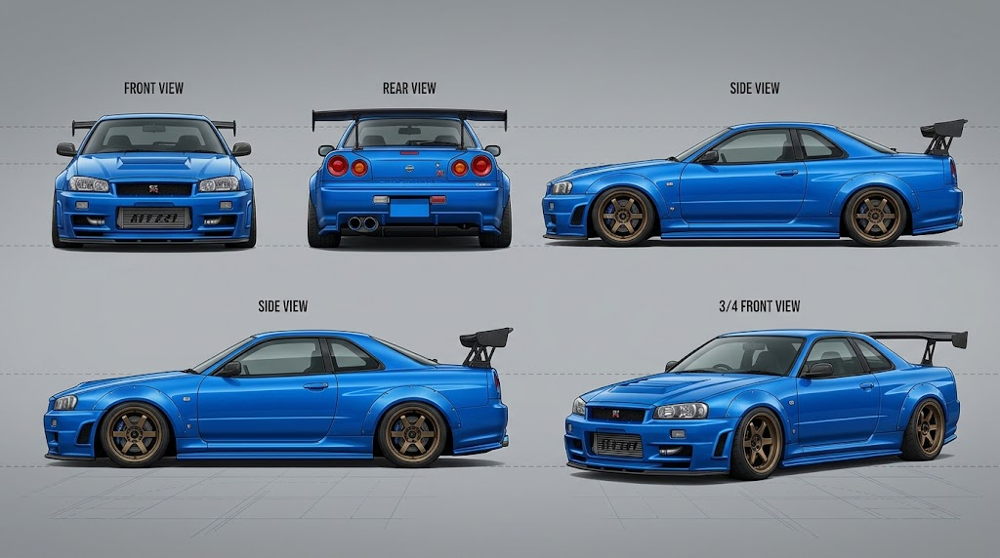

**High-fidelity in-browser 3D Japanese Touge racing and drift simulation built with Three.js, WebGL, React 19, and procedural Web Audio engine.**

[](https://touge-sakura-drift-3d.ai.studio)
[](https://react.dev/)
[](https://threejs.org/)
[](https://www.typescriptlang.org/)
[](https://vitejs.dev/)
[](https://tailwindcss.com/)

[**🎮 Play Online Now**](https://touge-sakura-drift-3d.ai.studio) · [**Key Features**](#-key-features) · [**Controls**](#-controls--hotkeys) · [**Car Roster**](#-vehicle-showroom--specs) · [**Maps**](#-race-environments) · [**Local Setup**](#-local-development)

</div>

---

## 🕹️ Play Instantly in Browser

Experience authentic mountain touge drifting directly from your browser—no installations or downloads required!

> 👉 **[Click here to play Touge & Sakura Drift 3D Online](https://touge-sakura-drift-3d.ai.studio)**

*Optimized for Chrome, Brave, Edge, Firefox, and Safari with 60+ FPS hardware-accelerated WebGL.*

---

## 🎮 In-Game Action & Drift Gameplay

Experience authentic drift dynamics, realistic tire smoke, procedural engine acoustics, dynamic day/night cycles, and live multiplayer tandem battles.

<div align="center">
  <table>
    <tr>
      <td width="50%">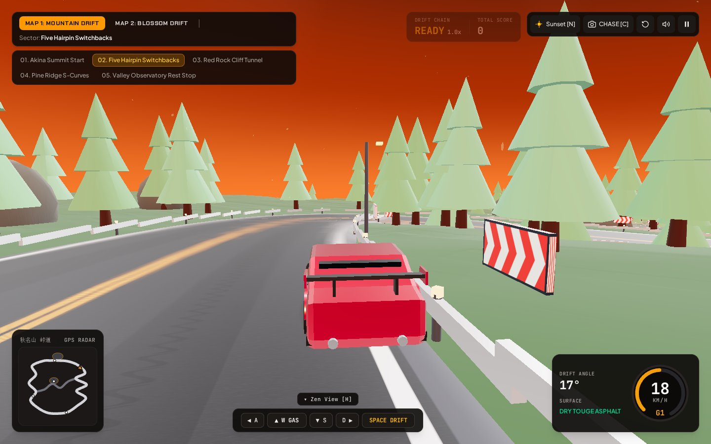<br /><b>🏎️ High-Speed Touge Drifting at Sunset</b></td>
      <td width="50%">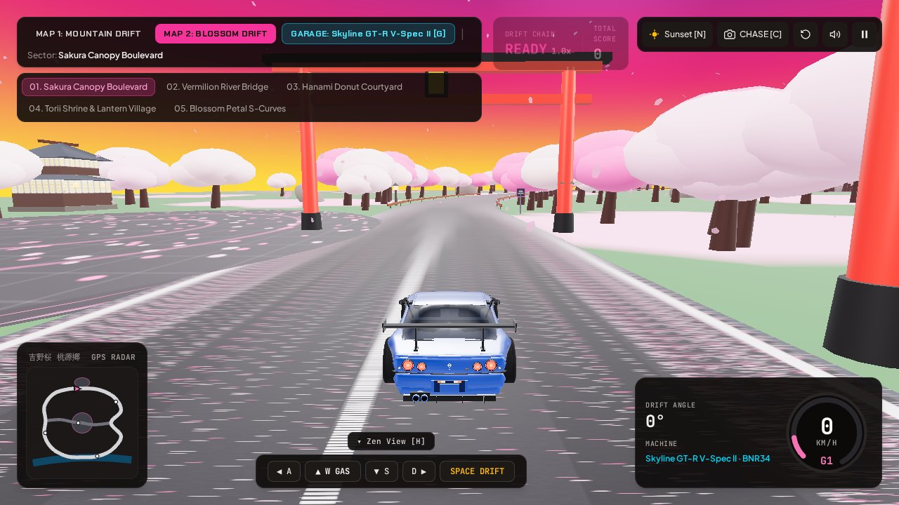<br /><b>🌸 Full-Throttle Yoshino Cherry Blossom Run</b></td>
    </tr>
    <tr>
      <td width="50%">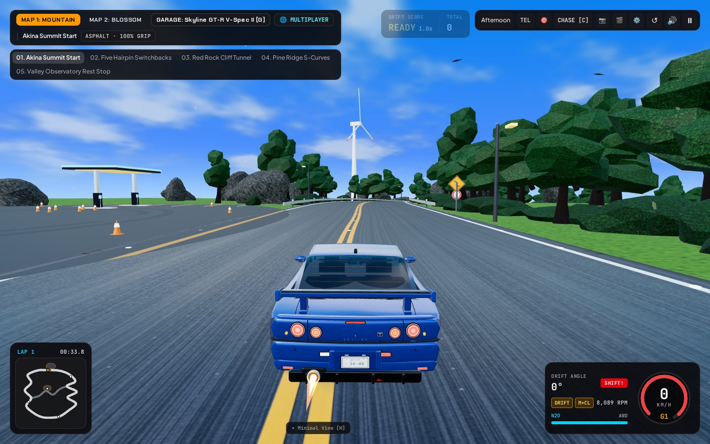<br /><b>📊 Telemetry HUD & Transmission Controls</b></td>
      <td width="50%">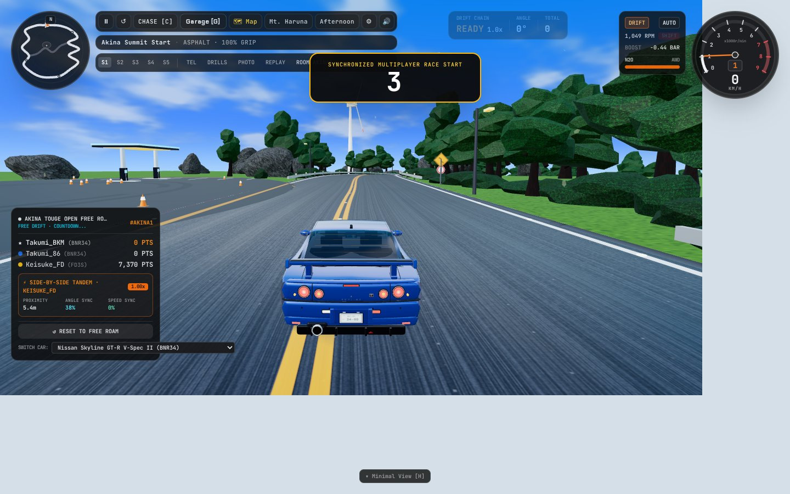<br /><b>🌐 Live Multiplayer Tandem Drift Battles</b></td>
    </tr>
  </table>
</div>

---

## 📸 Visual Showcase

### 🏁 JDM Legend Showcase — Skyline GT-R V-Spec II (BNR34)
<div align="center">
  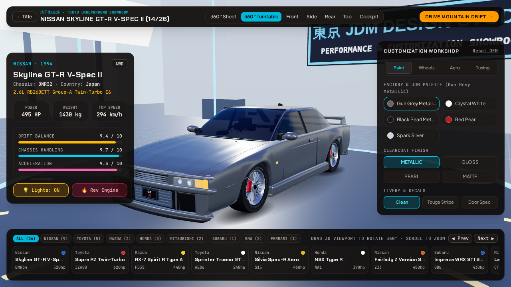
</div>

<div align="center">
  <table>
    <tr>
      <td width="33%">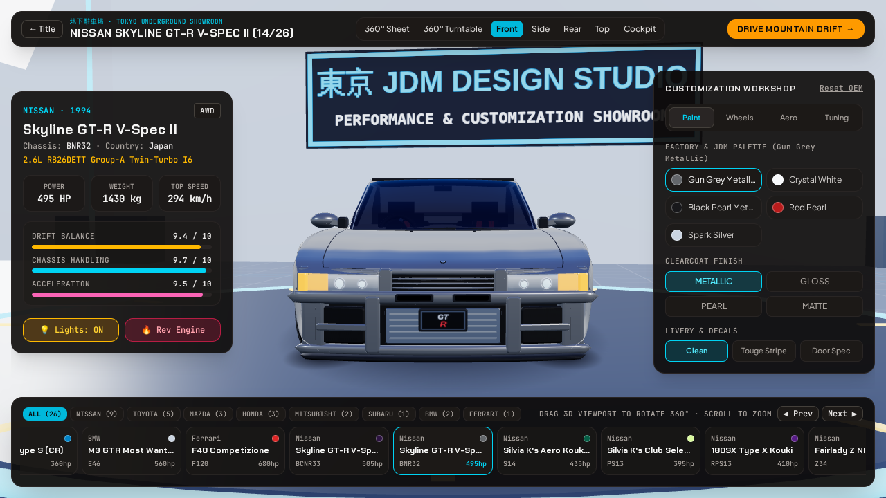<br /><b>Front Fascia & Cooling</b></td>
      <td width="33%">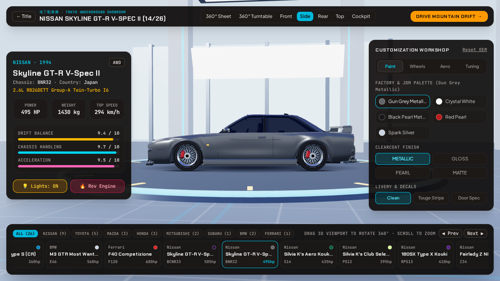<br /><b>Aero Profile & Stance</b></td>
      <td width="33%">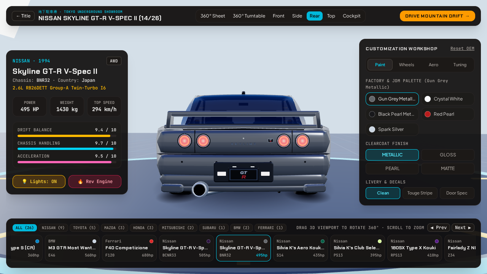<br /><b>Iconic Rear & Exhaust</b></td>
    </tr>
  </table>
</div>

### 🔧 3D Tuning Garage & Dyno Room
<div align="center">
  <table>
    <tr>
      <td width="50%">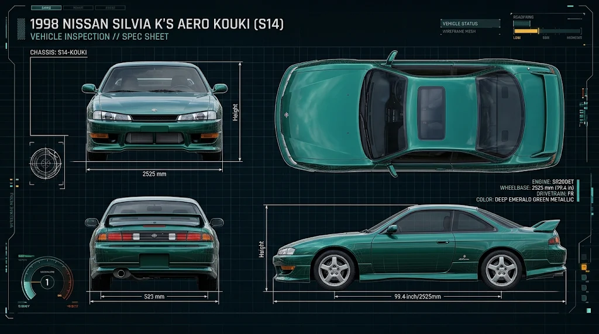<br /><b>Interactive 3D Tuning Showroom</b></td>
      <td width="50%">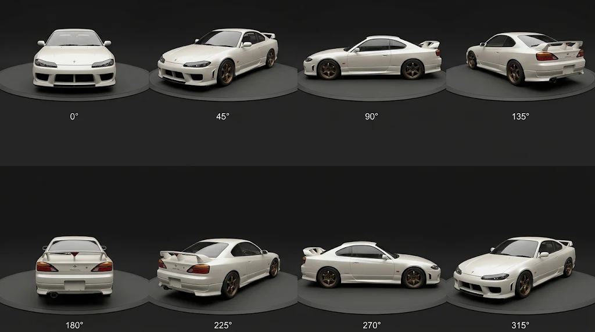<br /><b>Acoustic Dyno & Exhaust Testbed</b></td>
    </tr>
  </table>
</div>

### 🏔️ Akina Mountain Touge & 🌸 Yoshino Sakura Paradise
<div align="center">
  <table>
    <tr>
      <td width="50%">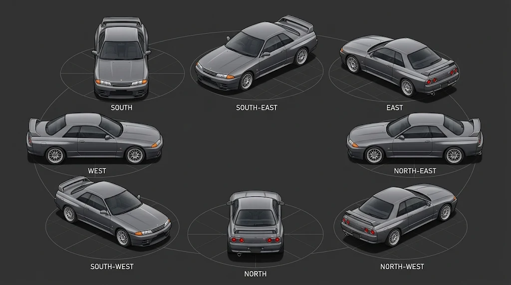<br /><b>Akina's Famous 5 Consecutive Hairpins</b></td>
      <td width="50%">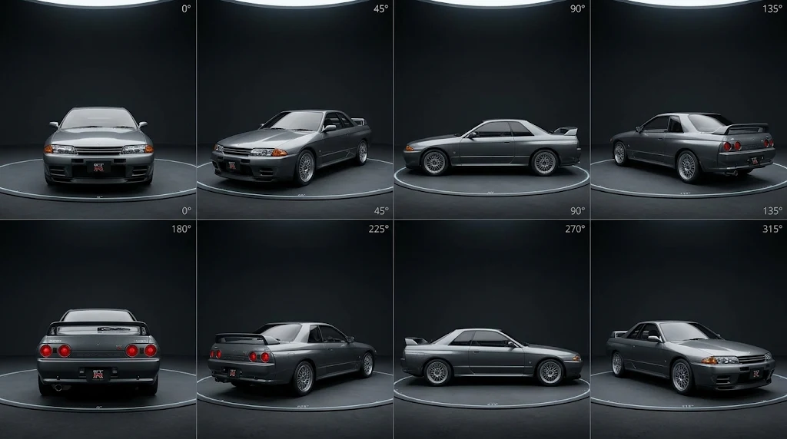<br /><b>Yoshino Cherry Blossom Paradise</b></td>
    </tr>
    <tr>
      <td width="50%">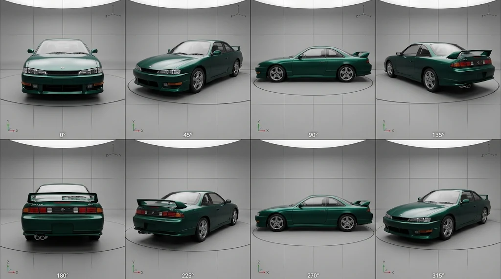<br /><b>Mount Akina Sunset Overlook</b></td>
      <td width="50%">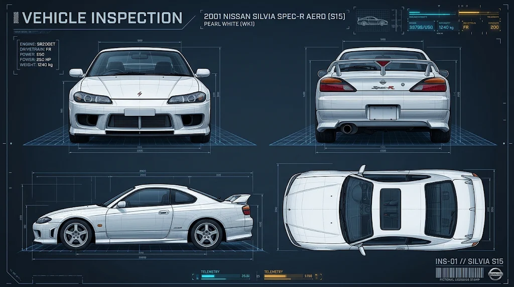<br /><b>Hanami Courtyard Drift Arena</b></td>
    </tr>
  </table>
</div>

### 📐 Precision CAD Blueprints
<div align="center">
  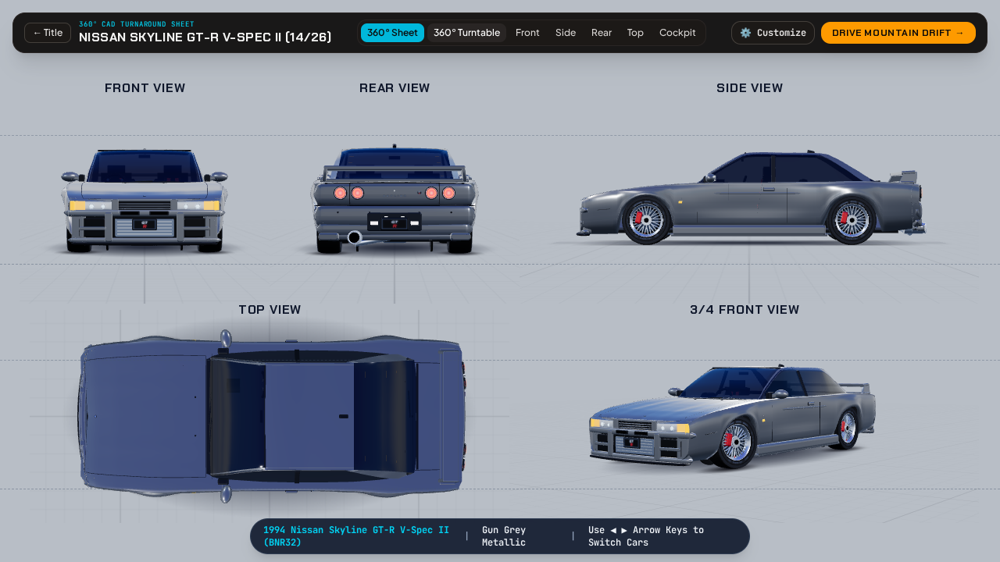
</div>

---

## ✨ Key Features

- **Realistic Drift Physics Engine**:
  - Longitudinal tire traction, lateral slip angles, weight transfer, and counter-steer assist.
  - Realistic handbrake initiate, clutch-kick dynamics, differential lock simulation, and downforce modeling.
  - Smooth dynamic camera with chase, hood, front bumper, cinematic drone, and spectator viewpoints.

- **26 Legendary JDM & Global Performance Cars**:
  - Fully modeled Japanese icons including BNR34, BNR32, BCNR33, Supra MK4 (JZA80), RX-7 (FD3S & FC3S), AE86 Sprinter Trueno, Silvia (S15, S14, S13), 180SX, NSX (NA1), Lancer Evolution (IX & X), Impreza WRX STI, S2000, F40, and more.

- **Dynamic 3D Japanese Environments**:
  - **Mount Akina Touge (秋名山 峠道)**: 2.8 km of high-altitude hairpins, sheer cliff guardrails, carved rock cliff tunnels, and valley overlooks.
  - **Yoshino Sakura Paradise (吉野 桜花郷)**: Vibrant cherry blossom boulevard, vermilion arched bridges, sacred Shinto shrine torii gates, and petal drift plazas.

- **3D Tuning Garage & Performance Customization**:
  - Paint finish options: Gloss, Metallic, Matte, Pearlescent, and Chrome.
  - Aftermarket aero body kits, GT wings, wheel rim styles (TE37 6-spoke, Work Meister, Watanabe, BBS mesh), ride height stance adjustment, and window tints.
  - Dynamic Dyno RPM pull and live exhaust rev acoustic test.

- **Procedural Web Audio Engine**:
  - Real-time synthesized engine audio profiles: Turbocharged RB26 inline-6, Twin-Rotor 13B Wankel, naturally aspirated 4A-GE, 2JZ-GTE twin-turbo, Boxer turbo, and high-rev VTEC screamers.
  - Authentic blow-off valve (BOV) flutter, backfire pops, tire squeals, and wind resistance effects.

- **Multiplayer & Game Modes**:
  - **Free Drift / Practice**: Freely explore and link corners across mountain passes.
  - **Touge Downhill Battle**: Head-to-head downhill drift duel.
  - **Time Attack & Sprint**: Precision apex clipping against the clock.
  - Real-time multiplayer synchronization via WebSockets with seamless offline HTTP fallback.

---

## 🎮 Controls & Hotkeys

| Key | Action |
|:---|:---|
| **W / Up Arrow** | Throttle / Accelerate |
| **S / Down Arrow** | Footbrake / Reverse |
| **A / Left Arrow** | Steer Left |
| **D / Right Arrow** | Steer Right |
| **Spacebar** | Handbrake / E-Brake (Initiate Drift) |
| **C** | Cycle Camera View (Follow, Hood, Bumper, Drone, Orbit) |
| **R** | Quick Vehicle Reset / Respawn on Track |
| **V** | Dyno Rev / Engine Acoustics Test (Garage & Track) |
| **L** | Toggle Vehicle Headlights / High Beams |
| **T** | Toggle Showroom Garage Lighting |
| **P** | Enter Photo Mode (Custom Depth of Field, Orbit & Filters) |
| **M** | Toggle Overhead GPS Radar / Mini-Map |
| **Esc / Tab** | Pause Menu / Telemetry & Settings |

---

## 🏎️ Vehicle Showroom & Specs

| Vehicle | Chassis | Engine | Power | Drivetrain | Weight |
|:---|:---|:---|:---|:---|:---|
| **Skyline GT-R V-Spec II** | BNR34 | 2.6L RB26DETT Twin-Turbo I6 | 520 HP | AWD | 1,560 kg |
| **Supra RZ Twin Turbo** | JZA80 | 3.0L 2JZ-GTE Twin-Turbo I6 | 580 HP | RWD | 1,510 kg |
| **RX-7 Type R Bathurst** | FD3S | 1.3L 13B-REW Sequential Twin-Turbo | 460 HP | RWD | 1,280 kg |
| **Sprinter Trueno GT-Apex** | AE86 | 1.6L 4A-GE High-Cam NA I4 | 225 HP | RWD | 940 kg |
| **Silvia Spec-R Aero** | S15 | 2.0L SR20DET Turbo I4 | 420 HP | RWD | 1,240 kg |
| **NSX-R** | NA1 | 3.2L C32B DOHC VTEC V6 | 380 HP | MR | 1,230 kg |
| **Fairlady Z / 350Z** | Z33 | 3.5L VQ35HR High-Rev V6 | 360 HP | RWD | 1,440 kg |
| **WRX STI Type RA** | GDB | 2.0L EJ207 Boxer-4 Turbo | 440 HP | AWD | 1,420 kg |
| **Lancer Evolution IX MR** | CT9A | 2.0L 4G63 MIVEC Turbo I4 | 480 HP | AWD | 1,410 kg |
| **S2000 AP1** | AP1 | 2.0L F20C 9,000 RPM VTEC I4 | 310 HP | RWD | 1,250 kg |
| **M3 Sport Evolution** | E46 | 3.2L S54 Naturally Aspirated I6 | 410 HP | RWD | 1,495 kg |
| **Skyline GT-R V-Spec** | BNR32 | 2.6L RB26DETT Twin-Turbo I6 | 500 HP | AWD | 1,430 kg |
| **Skyline GT-R V-Spec** | BCNR33 | 2.6L RB26DETT Twin-Turbo I6 | 510 HP | AWD | 1,530 kg |
| **180SX Type X** | RPS13 | 2.0L SR20DET Turbo I4 | 380 HP | RWD | 1,220 kg |
| **Chaser Tourer V** | JZX100 | 2.5L 1JZ-GTE Single-Turbo I6 | 490 HP | RWD | 1,470 kg |
| **RX-7 Infini** | FC3S | 1.3L 13B Turbo Rotary | 360 HP | RWD | 1,300 kg |
| **Roadster / MX-5** | NA | 1.8L BP-ZE Twin-Cam I4 | 210 HP | RWD | 990 kg |
| **F40 Competizione** | F40 | 2.9L Twin-Turbo V8 | 700 HP | RWD | 1,100 kg |

*(And 8 more classic and modern sports car variants available in the garage roster!)*

---

## 🗺️ Race Environments

```
                            [ AKINA SUMMIT START ]
                                       │
                      ▼ 5 Consecutive Hairpin Switchbacks ▼
                                       │
                         [ Red Rock Cliff Tunnel ]
                                       │
                         [ Pine Ridge S-Curves ]
                                       │
                          [ Valley Overlook Plaza ]
```

### 1. Mount Akina Touge Pass (秋名山 峠道)
- **Length**: 2.8 km
- **Elevation**: 340 m – 780 m
- **Road Width**: 14.5 m with asphalt banking, rumble strips, and safety guardrails.
- **Highlights**: The legendary five consecutive downhill hairpin turns, long high-speed tunnel through the mountain ridge, technical uphill S-curves, and summit rest plaza.

### 2. Yoshino Cherry Blossom Paradise (吉野 桜花郷)
- **Length**: 3.2 km
- **Theme**: Traditional Japanese garden and mountain village during springtime cherry blossom festival.
- **Highlights**: Continuous falling sakura petal particle effects, towering vermilion Torii gates, authentic wooden bridge crossings, and wide paved donut plazas designed for tandems and 360° entries.

---

## 🛠️ Local Development

### Prerequisites
- [Node.js](https://nodejs.org/) (v20 or higher recommended)
- `npm` (or `bun` / `pnpm`)

### Setup & Run
```bash
# 1. Clone the repository
git clone https://github.com/void4alt/carstreet.git
cd carstreet

# 2. Install dependencies
npm install --legacy-peer-deps

# 3. Start local development server
npm run dev

# 4. Open in browser
# Navigate to http://localhost:5173/ or http://localhost:3000/
```

### Production Build
```bash
# Compile and bundle static assets with Vite
npm run build

# Preview production build locally
npm run preview
```

---

## 🚀 GitHub Pages Deployment

This repository is configured with an automated GitHub Actions deployment workflow:

1. **Automatic Workflow**: On every push to `main`, `.github/workflows/deploy.yml` automatically installs dependencies, executes `npm run build`, and publishes the production `dist` bundle directly to GitHub Pages.
2. **Dedicated Branch**: A pre-built `gh-pages` branch is also maintained.
3. **How to Enable on GitHub**:
   - Go to your repository **Settings** -> **Pages**.
   - Under **Build and deployment** -> **Source**, select either:
     - **GitHub Actions** (recommended for automated continuous deployment)
     - OR **Deploy from a branch** -> branch: `gh-pages` / folder: `/ (root)`.
   - Your live game will be instantly playable at: **`https://touge-sakura-drift-3d.ai.studio`** (or via your GitHub Pages deployment)!

---

## 📜 Technology Stack

- **Graphics & 3D Core**: [Three.js](https://threejs.org/) (WebGL 2.0, procedural shaders, custom shadow maps, normal mapping, and particle systems)
- **UI & Architecture**: [React 19](https://react.dev/), [TypeScript](https://www.typescriptlang.org/)
- **Styling & HUD**: [Tailwind CSS 4](https://tailwindcss.com/), [Lucide React](https://lucide.dev/), [Motion](https://motion.dev/)
- **Sound System**: Web Audio API (real-time procedural oscillator & noise synthesis)
- **Build Tool**: [Vite 8](https://vitejs.dev/)
- **Multiplayer Backend**: Express, WebSockets (`ws`), Node.js

---

<div align="center">
  <sub>Engineered for speed, precision, and the love of classic JDM drift culture.</sub><br />
  <b>© Touge & Sakura Drift 3D</b>
</div>
